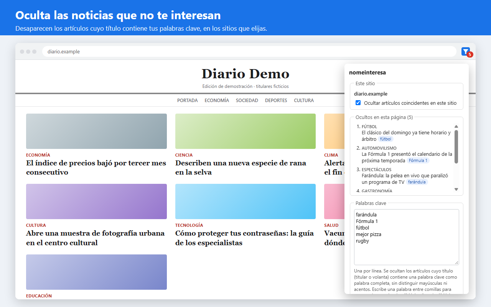
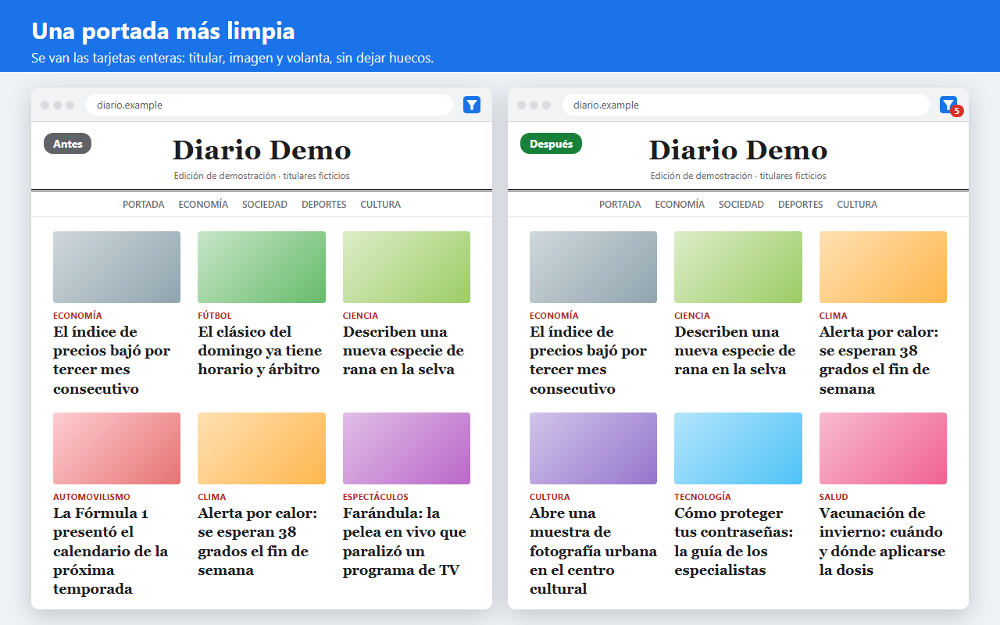
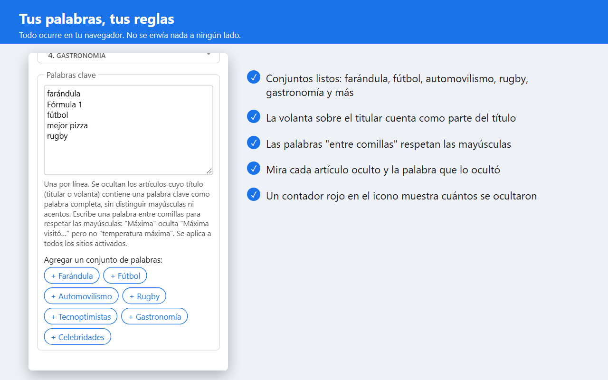
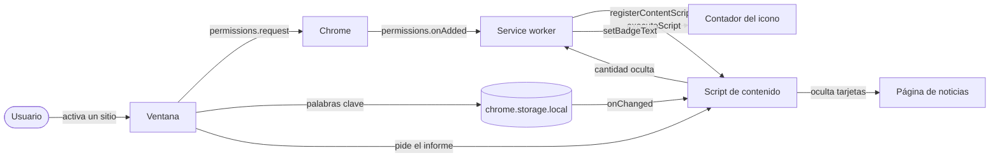

# nomeinteresa

[English](README.md) · **Español**

[](https://github.com/josefuentes4096/nomeinteresa/actions/workflows/ci.yml)
[](LICENSE)


Extensión de Chrome que **oculta las noticias cuyo titular contiene tus palabras clave**, en los sitios que elijas. El nombre viene de "no me interesa".



## Motivación

Este proyecto es **puramente académico**. Lo construí para practicar cómo llevar una extensión de navegador desde la idea hasta un producto listo para la tienda, con prácticas de ingeniería profesionales: especificaciones escritas, tests automáticos contra un navegador real, permisos mínimos, internacionalización y un proceso de publicación reproducible. No es un producto comercial y no está afiliado a ningún medio de comunicación. Los conjuntos de palabras predefinidos son ejemplos de temas habituales en las noticias; que un nombre aparezca en ellos no implica ninguna opinión sobre esa persona.

## Funciones

- **Filtra por titular:** se oculta un artículo cuando su titular, o la volanta que lo precede, contiene una de tus palabras clave como palabra o frase completa, sin distinguir mayúsculas ni acentos (`futbol` coincide con "Fútbol"; `gol` no coincide con "golpe").
- **Palabras que respetan mayúsculas:** escribe una palabra entre comillas dobles para que coincidan las mayúsculas. `"Máxima"` oculta "Máxima visitó La Haya" pero no "temperatura máxima".
- **Desaparecen las tarjetas enteras:** titular, imagen y resumen juntos, sin dejar huecos.
- **Solo donde quieras:** el filtro funciona únicamente en los sitios que actives desde la ventana de la extensión.
- **Conjuntos de palabras:** agrega conjuntos predefinidos con un clic (farándula, fútbol, automovilismo, rugby, tecnoptimistas, gastronomía, celebridades) y después edita la lista como quieras. Las listas se mantienen en orden alfabético.
- **Informe:** la ventana de la extensión lista los artículos ocultos en la página actual (volanta, titular y la palabra clave que coincidió) y cuántos son.
- **Contador:** el icono de la barra de herramientas muestra cuántos artículos se ocultaron en la pestaña actual, con un globo rojo como el de las notificaciones.
- **En vivo:** también se filtran los artículos que aparecen al desplazarte, y los cambios en tus palabras se aplican al instante en las pestañas abiertas.
- **Idiomas:** inglés y español, según el idioma de Chrome.

| Antes / después                                                              | Ventana de la extensión                                               |
| ---------------------------------------------------------------------------- | --------------------------------------------------------------------- |
|  |  |

_Las capturas usan una página de demostración ficticia, con titulares inventados (`store/assets-src/demo.html`)._

## Instalación

- **Chrome Web Store:** próximamente.
- **Modo desarrollador:** abre `chrome://extensions`, activa el **Modo de desarrollador**, haz clic en **Cargar descomprimida** y selecciona la carpeta **`extension/`**.

## Uso

1. Abre el sitio de noticias que quieres filtrar y haz clic en el icono de la extensión.
2. Agrega un conjunto de palabras (por ejemplo **+ Fútbol**) o escribe las tuyas, una por línea.
3. Activa **Ocultar artículos coincidentes en este sitio** y acepta el aviso de Chrome para permitir el acceso a ese sitio.

Para dejar de filtrar un sitio, desactiva la casilla. Las palabras clave son las mismas para todos los sitios activados.

## Cómo funciona



1. **Activar un sitio es concederle acceso.** El service worker convierte ese evento de permisos en la lista de sitios guardada, registra el script de contenido exactamente para los sitios concedidos y lo inyecta en las pestañas que ya están abiertas. Hacerlo en el worker y no en la ventana importa: la ventana puede cerrarse mientras Chrome muestra el aviso de permisos.
2. **Encontrar artículos.** El script de contenido toma como títulos los `h2`–`h6` y los elementos con "headline" o "title" en su clase. Los títulos que enlazan a la misma URL son del mismo artículo; decide solo el primero, el titular.
3. **Volantas.** El texto corto justo antes del titular dentro de la misma tarjeta (hasta 150 caracteres, nunca una firma, una fecha ni el resumen del artículo anterior) se compara junto con el titular.
4. **Ocultar tarjetas enteras.** Por cada coincidencia oculta el bloque más grande alrededor del título que no contiene otro artículo, sin subir a la estructura de la página ni al artículo que abriste (su `h1`).
5. **Al día.** Un `MutationObserver` filtra los artículos que se agregan después, antes de que se dibujen. Los cambios de ajustes vuelven a filtrar las pestañas abiertas sin recargar.

Los artículos ocultos solo reciben el atributo `data-nomeinteresa-hidden` y una regla de estilo los oculta. Al desactivar el filtro se quitan ambos y la página queda exactamente como estaba.

## Privacidad y permisos

La extensión **no se conecta con ningún servidor**: sin analíticas, sin telemetría, sin cuentas, sin código remoto. Tus palabras clave y sitios se guardan solo en tu navegador (`chrome.storage.local`). Lee la [política de privacidad](PRIVACY.md).

| Permiso                                 | Para qué se usa                                                                                 |
| --------------------------------------- | ----------------------------------------------------------------------------------------------- |
| `storage`                               | Guardar tus palabras clave y los sitios activados.                                              |
| `scripting`                             | Ejecutar el filtro en los sitios que activaste.                                                 |
| `activeTab`                             | Leer la dirección de la pestaña actual al abrir la ventana, para mostrar y activar su sitio.    |
| `optional_host_permissions` (`*://*/*`) | No se concede nada al instalar. El acceso se pide **por sitio**, solo cuando activas ese sitio. |

Puedes revisar o quitar el acceso a los sitios en cualquier momento en `chrome://extensions` → nomeinteresa → Detalles → Acceso a sitios.

## Limitaciones conocidas

- La detección es genérica. En sitios cuyos titulares no son encabezados ni tienen "headline" o "title" en su clase, puede que no encuentre los artículos.
- Las palabras clave coinciden con palabras completas: `gol` no oculta "goleada". Agrega las variantes que necesites.
- Una palabra entre comillas igual coincide cuando el título empieza con la palabra común: `"Máxima"` oculta "Máxima tensión en…".
- Algunas palabras sueltas quedan fuera de los conjuntos a propósito porque también son palabras comunes (por ejemplo "Boca", que también es la parte del cuerpo). Agrégalas tú si las quieres.
- En una página lenta, un artículo coincidente puede verse un instante antes de ocultarse en la primera carga.
- No funciona en páginas protegidas de Chrome (`chrome://`, Chrome Web Store).

## Aspectos de ingeniería

- **Desarrollo guiado por especificaciones.** El comportamiento se acuerda por escrito antes del código: la [spec 001](docs/specs/001-keyword-filter/spec.md) lista cada requisito, y cada criterio de aceptación enlaza al test que lo verifica. Un registro de decisiones explica por qué las cosas son como son.
- **Probado contra un navegador real, sin dependencias de tests.** Los tests end-to-end manejan Chrome headless por el protocolo de DevTools con un cliente propio y pequeño (`tests/e2e/chrome.js`) y ejecutan los scripts de contenido reales sobre páginas que reproducen el marcado de sitios de noticias: tarjetas con titular, volantas, páginas de artículo, artículos repetidos y scroll infinito. Los errores encontrados en sitios reales se convirtieron en páginas de prueba antes de corregirse.
- **JavaScript tipado, sin compilación.** Módulos ES con tipos JSDoc comprobados por TypeScript en modo `strict`. Lo que hay en `extension/` es exactamente lo que se publica.
- **Mínimos permisos.** Sin acceso a sitios al instalar; acceso por sitio pedido en tiempo de ejecución y revocable; ningún acceso a la red. Un test falla si el manifiesto pide más.
- **Núcleo puro, capa fina.** Las coincidencias y la detección de títulos y tarjetas viven en un archivo sin llamadas a `chrome.*`, así que el mismo código corre en los tests unitarios de Node, en los end-to-end y en la extensión.
- **Publicación reproducible.** `npm run package` genera el zip para la tienda con un escritor de ZIP sin dependencias; `npm run store-assets` regenera todas las imágenes de la tienda desde plantillas HTML usando la ventana y los scripts de contenido reales sobre una página ficticia. La CI genera el zip en cada push.
- **Internacionalizada y accesible.** Todo texto visible pasa por `chrome.i18n` (inglés y español, con un test que exige los mismos mensajes en ambos). Los cambios de estado se anuncian a lectores de pantalla y el foco siempre es visible.
- **Asistida por IA, dirigida por una persona.** Desarrollada con un agente de programación con IA (Claude Code) que trabaja bajo una constitución escrita del proyecto, [CLAUDE.md](CLAUDE.md): reglas no negociables, flujo de trabajo y convenciones de código. Cada cambio pasa los mismos controles de calidad.

### Controles de calidad

Cada push y pull request ejecuta estos controles en [GitHub Actions](.github/workflows/ci.yml):

| Control          | Cómo                                                                                                                                                                       |
| ---------------- | -------------------------------------------------------------------------------------------------------------------------------------------------------------------------- |
| Lint             | ESLint (configuración plana): reglas recomendadas más igualdad estricta, `const`/sin `var` y `console` restringido                                                         |
| Formato          | Prettier y EditorConfig                                                                                                                                                    |
| Tipos            | TypeScript en modo `strict` con `checkJs`, sobre JavaScript anotado con JSDoc                                                                                              |
| Tests unitarios  | `node:test`: coincidencia de palabras, validación de ajustes, conjuntos de palabras, texto del contador, límites de la tienda, paridad de traducciones y reglas del script |
| Tests end-to-end | Los scripts de contenido reales en **Chrome headless** sobre marcado realista de páginas de noticias, comprobando qué se oculta, qué informa la ventana y el contador      |
| Paquete          | Genera el zip para la Chrome Web Store y lo guarda como artefacto                                                                                                          |

## Desarrollo

Requisitos: Node.js 26 o superior, y Chrome para los tests end-to-end y las imágenes de la tienda.

```sh
npm install
npm run check          # lint + formato + tipos + tests unitarios
npm run test:e2e       # scripts de contenido en Chrome headless (define CHROME_PATH si Chrome no está en una ruta estándar)
npm run package        # dist/nomeinteresa-<versión>.zip para la Chrome Web Store
npm run store-assets   # regenera store/images/
npm run format         # formatea el código con Prettier
```

```
extension/                 La extensión (la carpeta que cargas en Chrome)
  manifest.json
  _locales/{en,es}/        Textos traducidos (chrome.i18n)
  background/
    service-worker.js      Permisos por sitio → registro del script de contenido; contador del icono
  content/
    filter-core.js         Coincidencias, detección de títulos y tarjetas, ocultado (puro, con tests)
    filter.js              Script de contenido: almacenamiento, observador, cambios de ajustes, informe
  shared/
    settings.js            Claves y validación de ajustes
    presets.js             Conjuntos de palabras predefinidos
    badge.js               Texto y colores del contador del icono
    messages.js            Nombres de los mensajes entre la ventana, el script de contenido y el worker
    i18n.js                Utilidades de traducción
  popup/                   Ventana de la barra de herramientas
tests/                     Tests unitarios (node:test)
  e2e/                     Tests end-to-end con Chrome real, con páginas de prueba en fixtures/
scripts/                   package.js (zip para la tienda), store-assets.js (imágenes de la tienda)
store/                     Textos de la ficha, respuestas de privacidad, imágenes y sus fuentes HTML
docs/specs/                Especificaciones (plantilla + una carpeta por spec)
docs/publishing.md         Lista de pasos para publicar en la Chrome Web Store
CLAUDE.md                  Constitución del proyecto: reglas, flujo de trabajo y convenciones
```

Lee [CONTRIBUTING.md](CONTRIBUTING.md) antes de enviar cambios y [SECURITY.md](SECURITY.md) para informar de vulnerabilidades.

## Autor

**Jose Fuentes** · [LinkedIn](https://www.linkedin.com/in/josefuentes4096/) · [GitHub](https://github.com/josefuentes4096)

## Licencia

[0BSD](LICENSE): úsala, cópiala, modifícala y distribúyela para cualquier fin, sin condiciones.
