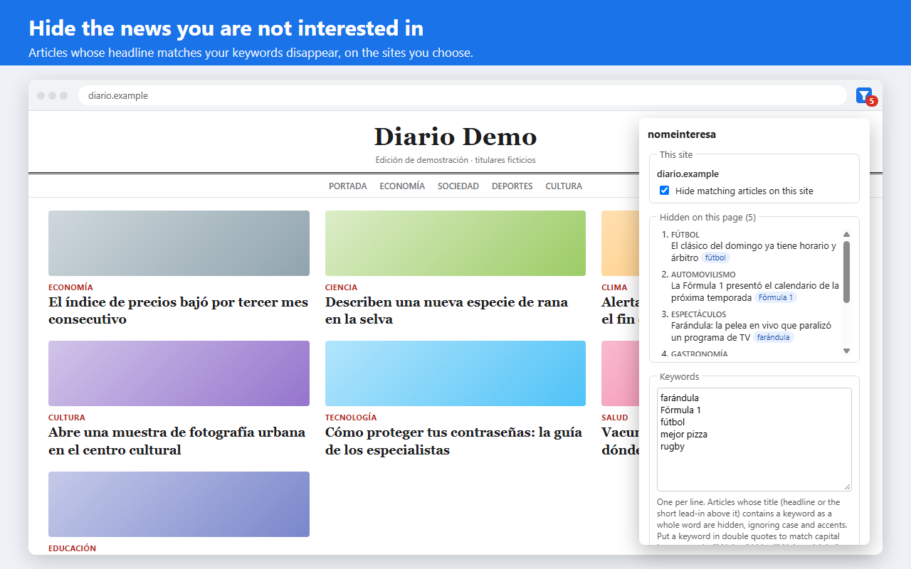
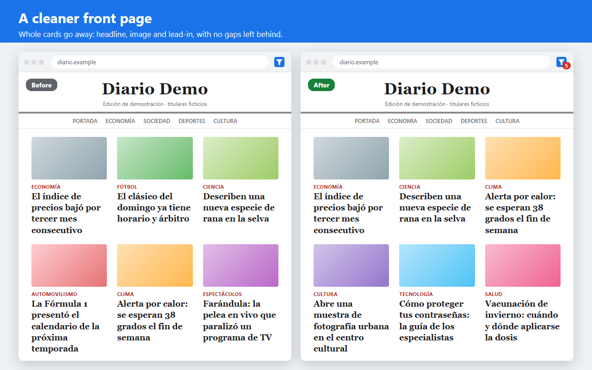
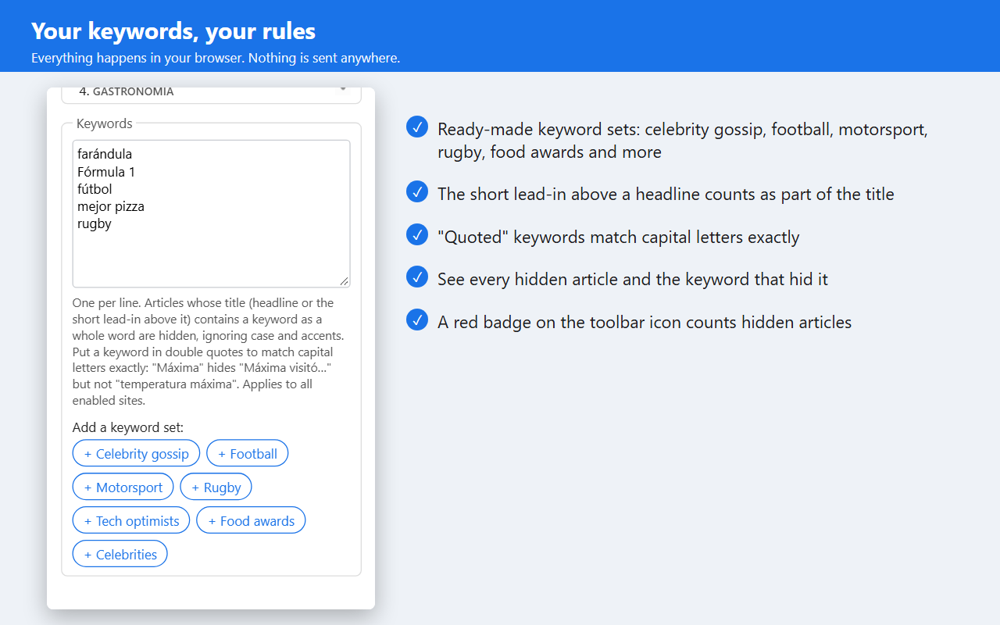
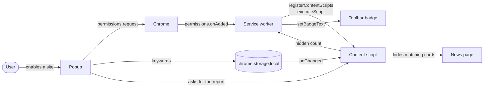

# nomeinteresa

**English** · [Español](README.es.md)

[](https://github.com/josefuentes4096/nomeinteresa/actions/workflows/ci.yml)
[](LICENSE)


Browser extension for **Chrome and Firefox** that **hides news articles whose headline contains your keywords**, on the sites you choose. The name comes from the Spanish _no me interesa_, "I'm not interested".



## Motivation

This project is **purely academic**. I built it to practice taking a browser extension from idea to store-ready product with professional engineering practices: written specifications, automated tests against a real browser, least-privilege permissions, internationalization and a reproducible release process. It is not a commercial product and is not affiliated with any media outlet. The predefined keyword sets are examples of common news topics; including a name in them implies no opinion about that person.

## Features

- **Filter by headline:** an article is hidden when its headline, or the short lead-in line above it, contains one of your keywords as a whole word or phrase, ignoring case and accents (`futbol` matches "Fútbol"; `gol` doesn't match "golpe").
- **Case-sensitive keywords:** write a keyword in double quotes to match capital letters exactly. `"Máxima"` hides "Máxima visitó La Haya" but not "temperatura máxima".
- **Whole cards disappear:** headline, image and summary go together, with no empty gaps.
- **Only where you want it:** filtering runs only on the sites you enable from the popup.
- **Keyword sets:** add predefined sets with one click (celebrity gossip, football, motorsport, rugby, tech optimism, food awards, celebrities) and edit the list as you like. Lists are kept in alphabetical order.
- **Report:** the popup lists the articles hidden on the current page (lead-in, headline and the keyword that matched) and how many there are.
- **Badge:** the toolbar icon shows how many articles are hidden on the current tab, as a red notification badge.
- **Live:** articles added while you scroll are filtered too, and keyword changes apply right away to open tabs.
- **Chrome and Firefox:** the same code and the same manifest run in both browsers.
- **Languages:** English and Spanish, following the browser's language.

| Before / after                                                               | Popup                                                                |
| ---------------------------------------------------------------------------- | -------------------------------------------------------------------- |
|  |  |

_Screenshots use a fictional demo page with made-up headlines (`store/assets-src/demo.html`)._

## Installation

- **Chrome Web Store:** coming soon.
- **Firefox Add-ons:** coming soon.
- **Chrome, developer mode:** open `chrome://extensions`, turn on **Developer mode**, click **Load unpacked** and select the **`extension/`** folder.
- **Firefox, temporary install:** open `about:debugging#/runtime/this-firefox`, click **Load Temporary Add-on…** and select **`extension/manifest.json`**. It stays installed until Firefox restarts.

Requires Chrome 121 or later, or Firefox 140 or later (desktop).

## Usage

1. Open the news site you want to filter and click the extension icon.
2. Add a keyword set (for example **+ Football**) or type your own keywords, one per line.
3. Turn on **Hide matching articles on this site** and accept the browser's prompt to allow access to that site.

To stop filtering a site, turn the toggle off. Keywords are shared by all enabled sites.

## How it works



1. **Enabling a site is granting host access to it.** The service worker turns that permission event into the stored site list, registers the content script for exactly the granted sites and injects it into tabs already open there. Doing this in the worker, not the popup, matters: the popup can close while Chrome shows the permission prompt.
2. **Finding articles.** The content script treats `h2`–`h6` and elements with "headline" or "title" in their class as titles. Titles that link to the same URL belong to the same article; only the first one, the headline, decides.
3. **Lead-ins.** The short text right before the headline inside the same card (up to 150 characters, never a byline, a date or the previous article's summary) is matched together with the headline.
4. **Hiding whole cards.** For each match it hides the largest block around the title that contains no other article, without climbing into the page layout or into the article the user opened (its `h1`).
5. **Keeping up.** A `MutationObserver` filters articles added later, before they are painted. Settings changes re-filter open tabs without a reload.

Hidden articles only get a `data-nomeinteresa-hidden` attribute and one stylesheet rule hides them. Turning filtering off removes both, leaving the page exactly as it was.

## Privacy and permissions

The extension **does not connect to any server**: no analytics, no telemetry, no account, no remote code. Your keywords and sites are stored only in your browser (`chrome.storage.local`). See the [privacy policy](PRIVACY.md).

| Permission                              | What it is used for                                                                              |
| --------------------------------------- | ------------------------------------------------------------------------------------------------ |
| `storage`                               | Save your keywords and enabled sites.                                                            |
| `scripting`                             | Run the filter on the sites you enabled.                                                         |
| `activeTab`                             | Read the current tab's address when you open the popup, to show and toggle its site.             |
| `optional_host_permissions` (`*://*/*`) | Nothing is granted on install. Access is requested **per site**, only when you enable that site. |

You can review or remove site access at any time: in Chrome, `chrome://extensions` → nomeinteresa → Details → Site access; in Firefox, `about:addons` → nomeinteresa → Permissions.

## Known limitations

- Detection is generic. On sites whose headlines are not headings and don't have "headline" or "title" in their class, articles may not be found.
- Keywords match whole words: `gol` doesn't hide "goleada". Add the variants you need.
- A quoted keyword still matches when a title starts with the common word: `"Máxima"` hides "Máxima tensión en…".
- Some single words are left out of the keyword sets on purpose because they are also common words (for example "Boca", which also means "mouth"). Add them yourself if you want them.
- On a slow page, a matching article may show for a moment before it is hidden on first load.
- It doesn't run on protected browser pages (`chrome://`, `about:`, the Chrome Web Store, addons.mozilla.org).

## Engineering highlights

- **Spec-driven development.** Behavior is agreed in writing before code: [spec 001](docs/specs/001-keyword-filter/spec.md) lists every requirement, and each acceptance criterion links to the test that verifies it. A decision log records why things are the way they are.
- **Tested against a real browser, with no test dependencies.** End-to-end tests drive headless Chrome over the DevTools protocol with a small in-house client (`tests/e2e/chrome.js`) and run the real content scripts on pages that reproduce real news-site markup: headline cards, lead-ins, article pages, duplicated articles and infinite scroll. Bugs found on live sites became fixtures before they were fixed.
- **Typed JavaScript, no build step.** Plain ES modules with JSDoc types checked by TypeScript in `strict` mode. What is in `extension/` is exactly what ships.
- **One manifest, two browsers.** The same `extension/` folder and the same zip run in Chrome and Firefox: the manifest lists the background script both as a service worker (Chrome) and as a background script (Firefox), plus Firefox's add-on settings. Mozilla's `web-ext lint` checks it in CI, and tests pin the shared-manifest rules.
- **Least privilege.** No host access at install; per-site access requested at runtime and revocable; no network access at all. A test fails if the manifest asks for more.
- **Pure core, thin shell.** Matching, title and card detection live in a file with no `chrome.*` calls, so the same code runs in Node unit tests, in end-to-end tests and in the extension.
- **Reproducible release.** `npm run package` builds the store zip with a dependency-free ZIP writer; `npm run store-assets` regenerates every store image from HTML layouts using the real popup and content scripts on a fictional demo page. CI builds the zip on every push.
- **Internationalized and accessible.** All UI text goes through `chrome.i18n` (English and Spanish, with a test enforcing that both have the same messages). Status updates are announced to screen readers and focus is always visible.
- **AI-assisted, human-directed.** Developed with an AI coding agent (Claude Code) working under a written project constitution, [CLAUDE.md](CLAUDE.md): non-negotiable rules, workflow and code conventions. Every change passes the same quality gates.

### Quality gates

Every push and pull request runs these checks in [GitHub Actions](.github/workflows/ci.yml):

| Gate             | How                                                                                                                                                        |
| ---------------- | ---------------------------------------------------------------------------------------------------------------------------------------------------------- |
| Lint             | ESLint (flat config): recommended rules plus strict equality, `const`/no `var`, and restricted `console`                                                   |
| Formatting       | Prettier and EditorConfig                                                                                                                                  |
| Firefox lint     | Mozilla's `web-ext lint` over `extension/`: the manifest and code are valid for Firefox                                                                    |
| Types            | TypeScript in `strict` mode with `checkJs`, over JSDoc-annotated JavaScript                                                                                |
| Unit tests       | `node:test`: keyword matching, settings validation, keyword sets, badge text, store limits, translation parity and content script rules                    |
| End-to-end tests | The real content scripts in **headless Chrome** on realistic news-page markup, checking exactly what is hidden, what the popup reports and the badge count |
| Package          | Builds the Chrome Web Store zip and keeps it as a build artifact                                                                                           |

## Development

Requirements: Node.js 26 or later, and Chrome for the end-to-end tests and the store images. Firefox is optional, for manual testing.

```sh
npm install
npm run check          # lint + Firefox lint + formatting + types + unit tests
npm run test:e2e       # content scripts in headless Chrome (set CHROME_PATH if Chrome is not in a standard location)
npm run package        # dist/nomeinteresa-<version>.zip for the Chrome Web Store and Firefox Add-ons
npm run store-assets   # regenerate store/images/
npm run format         # format the code with Prettier
```

```
extension/                 The extension (the folder you load in Chrome)
  manifest.json
  _locales/{en,es}/        Translated strings (chrome.i18n)
  background/
    service-worker.js      Site permissions → content script registration; toolbar badge
  content/
    filter-core.js         Matching, title and card detection, hiding (pure, tested)
    filter.js              Content script: storage, observer, settings changes, report
  shared/
    settings.js            Settings keys and validation
    presets.js             Predefined keyword sets
    badge.js               Toolbar badge text and colors
    messages.js            Message names between popup, content script and worker
    i18n.js                Localization helpers
  popup/                   Toolbar popup
tests/                     Unit tests (node:test)
  e2e/                     End-to-end tests against real Chrome, with test pages in fixtures/
scripts/                   package.js (store zip), store-assets.js (store images)
store/                     Store listing texts, privacy answers, images and their HTML sources
docs/specs/                Specifications (template + one folder per spec)
docs/publishing.md         Release checklist for the Chrome Web Store and Firefox Add-ons
CLAUDE.md                  Project constitution: rules, workflow and conventions
```

Read [CONTRIBUTING.md](CONTRIBUTING.md) before submitting changes and [SECURITY.md](SECURITY.md) to report vulnerabilities.

## Author

**Jose Fuentes** · [LinkedIn](https://www.linkedin.com/in/josefuentes4096/) · [GitHub](https://github.com/josefuentes4096)

## License

[0BSD](LICENSE): use, copy, modify and distribute it for any purpose, with no conditions.
